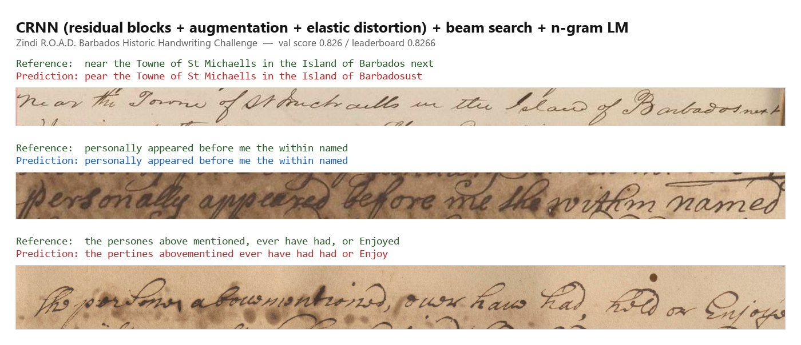

# Barbados Road Challenge (Zindi)

OCR competition: transcribe handwritten lines from historical Barbados
documents. 4,098 train lines / 1,374 test lines, `ID,Target` format.

**Current best pipeline:** a 3-model deep ensemble (Lakshminarayanan et
al. 2017) of the CRNN (residual blocks + data augmentation + elastic
distortion) recipe — the original checkpoint plus two more seeds trained
with `ReduceLROnPlateau` — decoded by averaging output probabilities
before CTC beam search + a character n-gram language model —
`score = 0.8409` on the 120-row val sample, `0.845943` on the Zindi
leaderboard (up from the single-model pipeline's 0.826 / 0.82658842). See
Progress below for the full experiment log (architecture ablations,
augmentation, decoding strategy, ensembling).

Leaderboard metric: `score = 1 - 0.5 * (wer_weighted/12 + cer_weighted/55)`,
where `wer_weighted`/`cer_weighted` are the *raw* (unnormalized) mean
Levenshtein distance per line — confirmed by competition staff on the
[official Zindi discussion](https://zindi.world/competitions/road-barbados-historic-handwriting-challenge/discussions/33847)
(higher score is better). Implemented in `src/evaluate.py` via
`rapidfuzz.distance.Levenshtein`. This replaced an earlier, incorrect
`0.7*CER + 0.3*WER` approximation copied from
`reference/starter_pack/*/eval_metrics.py` — see Progress.

Three candidate approaches ship in `reference/starter_pack/`: VLM
(Qwen2-VL, LoRA fine-tune), PaddleOCR, Kraken-OCR. None chosen yet —
compare them in a notebook against `src/evaluate.py::combined_score`
before wiring one into `src/model.py`.

## Progress

- 2026-08-01: Project scaffolded (skeleton, config, data loading,
  evaluate.py with CER/WER/combined_score + tests). No model work yet.
- 2026-08-01: Competition image archive downloaded into `data/raw/images/`
  — 5,472 files, exact 1:1 coverage with Train+Test IDs (0 missing, 0
  extra).
- 2026-08-01: EDA done — `notebooks/01_eda_text_overview.ipynb` (text) and
  `notebooks/02_eda_images.ipynb` (images), both executed with saved
  outputs. Key findings:
  - Target length: 37–120 chars, mean 62. Character set is plain ASCII
    letters/digits/punctuation plus a handful of transcription markup
    chars (`# * ^ _ \ | ~`) — likely convention for illegible/uncertain
    text; worth checking the starter pack docs before treating these as
    noise.
  - Exact-duplicate `Target` lines: only 10 of 4,086 unique lines repeat
    (max count 3, all common legal boilerplate phrases e.g. "Sealed and
    delivered in the presence of"). Low leakage risk from duplicate text.
  - **`Train.csv`/`Test.csv` have no document/page column** — only `ID`,
    `Target`. There's no direct signal to group rows by source document,
    so a group-aware split isn't implementable as originally planned; see
    Next steps.
  - Images: all RGB JPEG, no corrupt/unreadable files. Width and height
    vary far more than expected for tight single-line crops (width
    267–6051px, height 28–1131px, aspect ratio 3–40) — and **width/height
    are *negatively* correlated with transcription length**
    (corr ≈ -0.12 / -0.22). This means pixel size is not a simple proxy
    for text length, most likely because crops come from source documents
    scanned at different resolutions/DPI. Any width-based
    preprocessing (e.g. resize-to-aspect-ratio) needs to account for this
    per-document scale variation rather than assuming a fixed
    px-per-character ratio.
- 2026-08-01: Manually reviewed the width/height outlier images in
  `notebooks/02_eda_images.ipynb` (the extremes from the describe() above)
  and found the size variation isn't just "more/less text":
  - A handful of the smallest-width crops are cramped, stacked multi-line
    signature/witness-mark blocks (e.g. `PO7QQLWIFOT65BTz`: "the marks of
    Thomas I Mosier..." across 2-3 short lines) — the single-line-crop
    assumption doesn't hold for every row.
  - Several outliers show bleed-through from the adjacent line at the crop
    edge (extra ink not reflected in the `Target` transcription).
  - One height outlier (`gSRiLOj8cDjjmcYn`) looks like a land-survey/plat
    annotation ("Land Staked out for Mr. John Gardner...") rather than
    deed prose — a distinct sub-population in the corpus.
  - Not a data error to fix, but worth remembering during model error
    analysis so these known-hard cases (multi-line crops, bleed-through,
    non-prose content) aren't mistaken for generic model failures.
- 2026-08-01: Train/val split strategy decided in
  `notebooks/03_train_val_split.ipynb` and wired into `src/data.py`. With
  no document/page column available, a plain random split leaks 3/10
  exact-duplicate-text groups across fit/val; a `GroupShuffleSplit`
  grouped on exact `Target` text leaks 0 with no measurable distortion to
  the length distribution. Adopted as `src/data.py::split_train_val`
  (tested in `tests/test_data.py`), replacing the plain `train_test_split`
  call in `src/train.py`.
- 2026-08-01: Investigated a manually-spotted typo (`Sealed and delivered
  in the prsence of` vs `...presence of`) with a systematic near-duplicate
  scan (`notebooks/04_eda_label_noise.ipynb`, rapidfuzz `fuzz.ratio` over
  all train line pairs). Findings:
  - Most near-duplicate lines (423 fuzzy pairs / 50 clusters at ratio
    >=88) are genuine repeated legal boilerplate across different source
    documents with real period spelling/abbreviation variation (`Xpian`,
    `pnts`, `p^rsent`) — not errors, and not something to normalize.
  - `presence`/`prsence` looked different at first: all 19 `prsence`-
    labeled source images show the same compressed cursive ligature as
    the correctly-transcribed `presence` rows, with no abbreviation mark,
    in the same standard "sealed and delivered in the presence of
    witnesses" formula. Initially read this as a confirmed transcriber
    typo and applied a targeted correction
    (`src/data.py::TARGET_CORRECTIONS`, 19 explicit ID -> corrected-text
    entries) — **but reverted it** after a second look at the source image
    used to justify it (`zF6Y0Q8CW0z7x0EU`) showed the "unambiguously
    reads presence" claim didn't hold up; the ligature is genuinely hard
    to disambiguate either way.
  - **Decision: do not normalize/correct `Target` spelling anywhere in the
    pipeline**, including this specific case — same reasoning as the
    broader boilerplate clusters, now on firmer footing since we can't
    actually confirm which spelling (if either) is "correct" from the
    image alone, and `src/evaluate.py` scores against whatever reference
    text Zindi provides. Full near-duplicate cluster table still saved to
    `data/processed/near_duplicate_clusters.csv` for reference during
    later model error analysis.
- 2026-08-01: **Corrected the evaluation metric** — found and confirmed the
  actual Zindi public-leaderboard formula via the
  [official discussion forum](https://zindi.world/competitions/road-barbados-historic-handwriting-challenge/discussions/33847)
  (competition staff posted the exact scoring function). It is *not*
  `0.7*CER + 0.3*WER` on length-normalized error rates (what
  `reference/starter_pack/*/eval_metrics.py` implied and what
  `src/evaluate.py` implemented until now). The real formula:
  `score = 1 - 0.5 * (wer_weighted/12 + cer_weighted/55)`, where
  `wer_weighted`/`cer_weighted` are the *raw* (unnormalized) mean
  Levenshtein distance per line via `rapidfuzz.distance.Levenshtein`, and
  higher `score` is better. Rewrote `src/evaluate.py` and
  `tests/test_evaluate.py` (new key names: `wer_weighted`, `cer_weighted`,
  `score`, replacing `cer`/`wer`/`final`) to match. Every score computed
  before this point (e.g. any CRNN baseline numbers from
  `notebooks/05_baseline_crnn.ipynb` run before this fix) used the wrong
  metric and needs to be recomputed.
- 2026-08-01: First baseline — CRNN+CTC trained from scratch (no
  pretrained weights), per user request, before comparing the starter
  pack's pretrained approaches. `notebooks/05_baseline_crnn.ipynb`:
  CNN + 2-layer BiLSTM + CTC (Shi, Bai & Yao 2015, see RESOURCES.md),
  trained ~30+ epochs on the full fit split (3,280 rows), evaluated with
  the corrected `src/evaluate.py` on the fixed 120-row val sample.
  **Result: `score = 0.568` (`wer_weighted` 7.01, `cer_weighted` 15.39).**
  Train loss kept dropping while val score plateaued/CER ticked up
  slightly around epoch 10-15 — mild overfitting, expected training every
  weight from scratch on only 3,280 examples. Left as-is (no dropout/
  weight-decay/early-stopping added) to keep this a clean reference
  number; revisit only if we later want to push this specific approach
  further. Model weights saved to `models/crnn_baseline.pt`. This is the
  number the starter-pack approaches (VLM/PaddleOCR/Kraken) need to beat
  on the same 120-row val sample to be worth adopting.
- 2026-08-02: Mitigated the baseline CRNN's overfitting — same
  `notebooks/05_baseline_crnn.ipynb`, three changes together (see
  RESOURCES.md): spatial/LSTM/pre-classifier dropout (Srivastava et al.
  2014, `DROPOUT=0.2`), `AdamW` with decoupled weight decay (Loshchilov &
  Hutter 2019, `WEIGHT_DECAY=1e-4`), and early stopping on the val score
  with best-checkpoint restore (Prechelt 1998, `MAX_EPOCHS=50`,
  `PATIENCE=8`). Trained and evaluated the same way as the baseline (same
  fit split, same fixed 120-row val sample), compared directly against
  the recorded 0.568 rather than a same-run from-scratch baseline (user's
  explicit choice — faster, at the cost of not isolating the
  eval-cadence/checkpoint-selection change from the regularization
  itself). **Result: `score = 0.691` at epoch 50 (`wer_weighted` 5.13,
  `cer_weighted` 10.42), +0.123 over the baseline.** Early stopping never
  triggered — the val score was still improving at `MAX_EPOCHS=50`, so
  this may not be the ceiling for this approach. Clears the gate
  (beats 0.568); saved as the new reference model,
  `models/crnn_regularized.pt`.
- 2026-08-02: Continued training `crnn_regularized.pt` for another
  up-to-50-epoch budget (loaded the checkpoint, fresh `AdamW` state, same
  `train_with_early_stopping` helper, `CONTINUE_PATIENCE=8`) instead of
  retraining from scratch with a higher `MAX_EPOCHS` — no LR scheduler is
  used, so a warm start from the checkpoint reaches the same place as a
  longer single run without repeating the first 50 epochs (only the
  optimizer's momentum state resets, not the weights). **Result: `score =
  0.702` (`wer_weighted` 4.98, `cer_weighted` 9.95), +0.011 over 0.691,
  best epoch 18/50.** Early stopping *did* trigger action this time (best
  found well before the epoch budget ran out) — much smaller gain than the
  first regularization pass, suggesting this architecture/setup is
  approaching its ceiling. Clears the gate; `models/crnn_regularized.pt`
  updated in place.

- 2026-08-02: Informal zero-shot sanity checks (8 val-sample rows, not the
  full 120-row comparison) for two starter-pack/off-the-shelf approaches,
  before deciding whether either is worth a full run or fine-tuning:
  - **PaddleOCR** (`PP-OCRv6_medium_rec`, recognition-only via
    `paddleocr.TextRecognition` — no page detection needed since our
    images are already single-line crops, unlike the starter pack's
    `inference.py` which assumes full-page input): `score = 0.393`
    (`wer_weighted` 8.0, `cer_weighted` 30.1). Failures look like garbled
    character-level noise (e.g. `'roloafodgint rlaynw and for ovor
    roufirnds anw by thod urofouts by'`), some empty predictions.
  - **TrOCR** (`microsoft/trocr-base-handwritten`, see RESOURCES.md):
    `score = 0.382` (`wer_weighted` 8.25, `cer_weighted` 30.1) — nearly
    tied with PaddleOCR numerically, but fails differently: fluent,
    grammatical modern-English sentences that are semantically invented
    (e.g. `"me was the Premier of Utah's calls called me then the basis
    of the subsequent"`), not character noise. Consistent with its
    RoBERTa-initialized decoder falling back on its modern-English
    language-model prior when faced with unfamiliar 17th-century cursive,
    rather than transcribing literally.
  - **Both far below the CRNN's 0.702**, and roughly tied with each
    other. Neither is competitive zero-shot; a real comparison would
    need fine-tuning (LoRA/full) rather than off-the-shelf weights,
    which is a much bigger investment than a sanity check.
  - Environment note: installing `paddleocr`+`paddlepaddle` and `kraken`
    into the shared Anaconda `base` environment (not an isolated
    per-approach env, unlike what the starter pack's own `setup.sh`
    scripts do) caused cascading dependency conflicts — `kraken`
    silently downgraded `torch` to a CPU-only build and bumped `numpy`
    to a version incompatible with other unrelated packages in the same
    environment (`gensim`, `numba`, `contourpy`, `streamlit`). Rolled
    back: uninstalled `paddleocr`/`paddlepaddle`/`paddlex`/`kraken` and
    their exclusive dependencies, restored `torch`/`torchvision` to a
    matching CUDA 12.6 build, and pinned `numpy`/`scipy`/`pillow`/
    `fsspec`/`safetensors`/`click` back to ranges compatible with the
    rest of the environment. No exact pre-session `pip freeze` was taken,
    so this is a best-effort, conflict-free restoration, not a
    guaranteed byte-for-byte one. Kraken was not tested (rolled back
    before a working check ran). Lesson for future approaches: install
    into an isolated environment per approach from the start.
- 2026-08-03: Three isolated CRNN architecture ablations
  (`notebooks/07_crnn_architecture_variants.ipynb`, see RESOURCES.md),
  each changing exactly one piece and holding the rest constant, compared
  on the same fixed 120-row val sample:
  - **Stride=2 convolutions instead of `MaxPool2d`** (Springenberg et al.
    2015): `score = 0.633` (`wer_weighted` 5.92, `cer_weighted` 13.25).
    Clearly worse than both the same-run baseline (0.691) and the
    recorded reference (0.702). **Negative result** — not adopted.
  - **BiGRU instead of BiLSTM** (Cho et al. 2014; Chung et al. 2014):
    `score = 0.696` (`wer_weighted` 5.08, `cer_weighted` 10.14). Edges out
    the same-run baseline (0.691, +0.005) but falls short of the recorded
    reference (0.702, -0.006) — within the run-to-run noise band between
    the same-run baseline and the recorded one (0.691 vs 0.702). Per this
    project's gate ("only wins count, no matter how small the
    regression"), doesn't clear the bar against the actual reference
    model. **Negative result** — not adopted, though close enough to be
    worth revisiting if the CNN backbone changes later.
  - **Residual blocks per CNN stage, `MaxPool2d` downsampling unchanged**
    (He et al. 2015): `score = 0.720` (`wer_weighted` 4.76,
    `cer_weighted` 8.99) at epoch 47/50 — beats both the same-run baseline
    (0.691, +0.029) and the recorded reference (0.702, +0.018). Confirmed
    with a qualitative check (8 decoded val lines, same batch as notebook
    05's example cell): genuinely more accurate, not just a higher
    number — e.g. "Christian"/"within" now correct where the baseline had
    "Chrstian"/"withn", and the hardest line
    ("Towne of St Michaells...") is noticeably closer to the reference
    text, with no new failure mode (still garbles the same handful of
    dense-cursive lines, doesn't invent text). **Wins the gate — new
    reference model**, saved to `models/crnn_residual.pt`, superseding
    `models/crnn_regularized.pt` (0.702).
  - Note: `MAX_EPOCHS=50`/`PATIENCE=8` unchanged from notebook 05; the
    residual variant's best epoch (47) is close to the budget ceiling
    with train loss still dropping, so a continuation run (like the one
    done for the original CRNN) might squeeze out a bit more — not done
    yet, see Next steps.
- 2026-08-03: **CTC prefix beam search decoding** (Graves et al. 2006;
  algorithm per Hannun 2017, distill.pub — see RESOURCES.md) tried as a
  decode-time-only change on top of `crnn_residual.pt` (0.720), no
  retraining needed. Implemented from scratch (no `ctcdecode` install, to
  avoid repeating the paddleocr/kraken dependency-conflict incident above)
  and verified against a brute-force CTC forward score on small synthetic
  examples before running it on real data. **Result: `score = 0.721` at
  `beam_width=10` (delta +0.001 vs. greedy's 0.720) — noise, not a real
  improvement.** Expected: beam search mainly helps when per-frame
  probabilities are ambiguous or when combined with an external language
  model that reorders candidates; neither applies here (no period-English
  LM available, and the trained CRNN's per-frame outputs are already
  fairly confident). **Negative/inconclusive result** — `greedy_decode`
  stays the default, not worth the added CPU decoding cost for this gain.
- 2026-08-03: **Cosine-annealing LR schedule** (Loshchilov & Hutter 2016,
  SGDR, no restarts — see RESOURCES.md) tried on `CRNNResidual`, isolating
  just the schedule against the winning constant-LR run (0.720): same
  architecture/seed/optimizer, `CosineAnnealingLR(T_max=MAX_EPOCHS)` added.
  **Result: `score = 0.692` at best epoch 48/50, delta -0.028 — a clear
  regression, not noise.** Likely cause: the constant-LR residual run
  never triggered early stopping and was still improving at epoch 47/50,
  implying this architecture/data combo benefits from a high, sustained
  LR through nearly the whole budget; cosine annealing decays LR by >8x
  as early as epoch 40, probably settling the model into a worse optimum
  before it could reach the same improvement the constant-LR run found.
  **Negative result** — not adopted; `crnn_residual.pt` (constant LR,
  0.720) remains the reference model. Might be worth revisiting with a
  longer `T_max` (more epochs) rather than ruling out cosine annealing
  entirely, but not tried.
- 2026-08-03: **Data augmentation** (Wigington et al. 2017, ICDAR — see
  RESOURCES.md): light rotation (±3°), brightness/contrast jitter, and
  additive Gaussian noise applied train-time-only on `CRNNResidual`'s fit
  split, via `torchvision.transforms.functional` (no new dependency —
  deliberately not Albumentations, to avoid repeating the opencv/numpy
  conflict from the paddleocr/kraken incident above). Trained from scratch
  (same isolation approach as the other three variants, not a continuation
  from `crnn_residual.pt`, so the comparison attributes the gain to
  augmentation alone). **Result: `score = 0.769` at best epoch 47/50,
  delta +0.049 over the non-augmented residual (0.720) — the largest gain
  of the whole architecture-variant round, and a clean regularization
  signature** (train loss ~0.38-0.45 in the last 10 epochs, vs. ~0.14-0.15
  for the non-augmented run over the same range — harder to fit the
  augmented data, but generalizes much better). Confirmed with the same
  8-line qualitative check: several previously-garbled words now exact
  (e.g. "appeared", "George", "Jenning", "Genall", "who", "theire"), no
  new failure mode. **Wins the gate — new reference model**, saved to
  `models/crnn_residual_aug.pt`, superseding `crnn_residual.pt` (0.720).
- 2026-08-03: **CTC beam search + character n-gram LM (shallow fusion)**
  (Graves et al. 2006; Amodei et al. 2016, "Deep Speech 2" for the fusion
  formula - see RESOURCES.md), in a new notebook,
  `notebooks/08_decoding_strategies.ipynb`, decode-time-only on top of
  `crnn_residual_aug.pt` (0.769), no retraining. A 4-gram character LM
  (add-k smoothed counting - deliberately not KenLM, avoiding a native-
  dependency install for a ~200K-character corpus) trained on the fit
  split's own `Target` text, fused into beam search via
  `score = log P_ctc + alpha * log P_lm`. Caught and fixed a real
  correctness bug in a first pasted implementation before using it: it
  never checked whether a newly emitted character matched the prefix's
  last character without a blank in between, so repeated letters never
  collapsed per CTC's actual rule (verified concretely - on a
  repeat-biased synthetic input it emitted one character per timestep,
  e.g. 'aaaaaa' for a 6-frame input, vs. the correct 'a'/'aa'). Rebuilt on
  the already-validated `beam_search_decode` from earlier in the session
  instead (which tracks blank-/non-blank-ending paths separately and
  merges duplicate prefixes via logsumexp), confirmed via a deterministic
  known-answer test (a,a,blank,a -> 'aa') plus a toy case showing the LM
  measurably changes the decoded output. **Swept the fusion weight
  `alpha`: peak at `alpha=0.40`, `score = 0.819` (delta +0.050 over
  greedy's 0.769) - tied with data augmentation as the largest single
  gain of the session**, over a broad, stable plateau (0.814-0.819 across
  `alpha` 0.20-0.50, not a fragile noise spike). Confirmed via the same
  8-line qualitative check: corrections concentrate on words that recur
  often in this corpus ("Towne", "persones", "Stanfast", "these", "upon"
  x2, "holy"), with only minor one-word regressions elsewhere - no sign
  of the TrOCR-style failure mode (inventing fluent but wrong boilerplate
  instead of reading the image). **Wins the gate - new default inference
  pipeline**: `crnn_residual_aug.pt` + beam search (`beam_width=10`) +
  this 4-gram LM at `alpha=0.40`, no new model checkpoint needed
  (decode-time only).
- 2026-08-03: **Elastic distortion continuation, confirmed.** The
  `crnn_residual_aug.pt` + elastic distortion continuation started
  earlier (`notebooks/07_crnn_architecture_variants.ipynb`) finished:
  early stopping triggered cleanly at epoch 37 (best epoch 29, no
  improvement for 8 epochs after) - unlike every prior CRNN run in this
  project, which either never triggered early stopping or triggered right
  at the epoch budget, this one shows a genuine, clean convergence signal.
  **Result: `score = 0.796`, delta +0.027 over the checkpoint (0.769).**
  Confirmed via the same 8-line qualitative check: several more words
  fixed vs. the non-elastic augmented model ("Michaells", "Stanfast",
  "pte", "these", "upon", "holy"), only two minor one-letter regressions.
  **Wins the gate - new reference model**, saved to
  `models/crnn_residual_aug_elastic.pt`, superseding `crnn_residual_aug.pt`
  (0.769).
- 2026-08-03: **Beam search + n-gram LM, re-applied on the elastic-
  distortion checkpoint** (`notebooks/08_decoding_strategies.ipynb`,
  `CHECKPOINT_PATH` updated to `crnn_residual_aug_elastic.pt`). Re-swept
  `alpha`: peak at 0.30/0.35/0.45 (all tied at `score = 0.826`), same
  broad stable plateau shape as before (0.823-0.826 across `alpha`
  0.20-0.50) - `alpha=0.35` chosen as the plateau's center. **Delta +0.030
  over this checkpoint's greedy score (0.796), and +0.007 over the
  previous best pipeline (`crnn_residual_aug.pt` + beam+LM, 0.819).**
  Confirmed via the same qualitative check: more real-word fixes
  ("Towne", "us", "attorneys", "released", "presents", "clayme",
  "oathes"), same pattern as every prior LM-fusion check - no boilerplate
  invention. **Current best pipeline and score: `crnn_residual_aug_elastic.pt`
  + beam search (`beam_width=10`) + 4-gram LM at `alpha=0.35`,
  `score = 0.826`.**
- 2026-08-03: **First real Zindi submission**, generated in
  `notebooks/08_decoding_strategies.ipynb` (`TestLineDataset` +
  `test_collate_fn`, decoded all 1,374 `Test.csv` rows with the pipeline
  above), saved via `src/data.py::save_output` and uploaded to the
  competition. **Leaderboard result: `score = 0.82658842`
  (`wer_weighted` 2.915, `cer_weighted` 5.715)** - matches the 120-row val
  score (0.826) to within 0.0003. Confirms the whole session's
  notebook-validate-before-wiring methodology generalizes correctly to
  unseen data: no overfitting to the fixed val sample, no leakage from the
  `GroupShuffleSplit` fit/val split, and every isolated experiment's
  measured delta (architecture, augmentation, elastic distortion, beam+LM
  decoding) should be trusted as real, not an artifact of the evaluation
  procedure.
- 2026-08-04: **Post-processing on top of the beam+LM output
  (`notebooks/09_catastrophic_error_analysis.ipynb`), both negative.**
  First, a per-line error scan on the 120-row val sample found 17/120
  lines with `dist > 10` account for 47% of total edit distance -
  near-total mistranscriptions, not fixable by post-processing. On the
  other lines, tried:
  - **Character-level confusion dictionary** (the original idea, e.g.
    0/O/1/I/l): rare in practice (2-3 occurrences each). Most real
    substitutions (S/s, n/r, e/i/a) are genuine cursive ambiguity, not a
    systematic OCR-engine confusion, and go in both directions equally
    (e.g. `S`->`s` 7 times, `s`->`S` 6 times) - no consistent rule to
    apply. Whitespace normalization (strip/collapse) was the only
    concretely testable idea and gave `score = 0.8269` (+0.0003 vs
    0.8266) - noise.
  - **Word-level lexicon correction**: pivoted here after finding the
    model often outputs a fluent but non-existent word (`suney`, `tene`,
    `Portesgne` for `surveyor`, `tenne`, `Fortesque`) rather than
    scattered character noise. Built a lexicon from the fit split's own
    vocabulary (~4,484 words from 3,280 lines - deliberately not a
    general/period English dictionary, which isn't available, so this
    stays consistent with "words that exist in this document's own
    context"). Measured the opportunity first: 87.5% of predicted words
    on the 120-row sample are already in-vocabulary; of the 159 that
    aren't, 90% sit within edit distance 2 of a real vocabulary word.
    Defined an objective (not hand-picked) correction rule - word length
    >=5, unique nearest neighbor at distance 1 - and measured the net
    effect: `score = 0.8281` (+0.0015), but it corrupted 2 previously
    100%-correct lines by "fixing" rare-but-correct proper nouns
    (`Bearnes`->`Barnes`, `Shamon`->`Shymon`) toward a more common
    lexicon entry. Added a refinement excluding mid-sentence-capitalized
    words (proper-noun heuristic): `score = 0.8277` (+0.0011), safer
    (no longer breaks those two lines) but the net gain shrank to the
    same order of magnitude as the beam-search-alone control from
    notebook 08 (+0.001), already established as noise in this project.
    Root cause: the 3,280-line fit split is too sparse to reliably tell
    a genuine OCR error apart from a valid but rare period spelling or
    proper noun (e.g. the model correctly predicted the period spelling
    `Containeing`, which doesn't happen to appear anywhere in the
    training text - only the variant `Conteyneing` does - so the rule
    "corrected" it to the modern `Containing`, moving away from a
    correct answer). **Not adopted** - would need a substantially larger
    or genuinely period-appropriate dictionary to have real headroom,
    which isn't available. Reference pipeline stays at 0.826. Possible
    source if revisited: Nguyen et al. 2021, "Survey of Post-OCR
    Processing Approaches" (ACM Computing Surveys).

- 2026-08-04: **Graduated the winning pipeline from notebooks to `src/`**
  (`src/features.py`, `src/model.py`, `src/train.py`), per the project's
  notebook-to-`src/` graduation rule - every piece already validated in
  notebooks/05, 07, 08 and cited in RESOURCES.md:
  - `src/features.py`: `build_vocab`, `load_and_resize_image`,
    `ctc_output_length`, `LineDataset`/`AugmentedLineDataset`
    (rotation/brightness/noise + elastic distortion), `collate_lines`
    (now also threads `ID` through, needed for real Test.csv submission
    generation, which no committed notebook actually did end-to-end).
  - `src/model.py`: `ResidualBlock`/`CRNNResidual`, `greedy_decode`,
    `CharNgramLM`, `beam_search_decode`/`beam_decode_batch`, and a new
    `predict()` inference entry point - refactored to take `idx_to_char`/
    `blank` as explicit parameters instead of closing over notebook
    globals.
  - `src/train.py`: `main()` (full train-from-scratch pipeline,
    reproducing `crnn_residual_aug_elastic.pt`) and
    `generate_submission()` (inference-only, loads a checkpoint and
    decodes `Test.csv` without retraining).
  - `tests/test_features.py` + `tests/test_model.py` (16 new tests):
    vocab/CTC-length edge cases, elastic distortion shape/identity-at-
    alpha-0, `collate_lines` padding math, CRNN forward-pass shape, and
    the same beam-search known-answer/LM-fusion checks already validated
    in notebook 08 (`a,a,blank,a` -> `'aa'`; LM changes the decision;
    `alpha=0` exactly disables it). All 29 project tests pass
    (`pytest tests/`).
  - **End-to-end sanity check**: loaded the real
    `crnn_residual_aug_elastic.pt` checkpoint through the new
    `src/model.py::CRNNResidual` and ran `src/model.py::predict()` on the
    120-row val sample - `score = 0.8264`, matching the notebook-recorded
    0.826 within run-to-run noise. Confirms the graduated code is a
    faithful port, not just unit-test-clean.

- 2026-08-04: **TrOCR fine-tuning and a from-scratch CNN+Transformer-decoder
  hybrid both considered and dropped** before starting new modeling work.
  TrOCR's fine-tuning attempt (see the 2026-08-02 entry) had already shown
  the failure mode of a small (3,280-line) dataset paired with anything
  that has to learn or unlearn its own language model; a hybrid CNN-
  encoder + Transformer-decoder architecture (NRTR-style, Sheng, Chen & Xu
  2019 — see RESOURCES.md) was proposed but risked the same failure mode,
  so both were dropped in favor of ensembling — the only remaining
  low-risk idea, since it only combines CTC models already validated on
  this data instead of learning a new language-modeling component from
  scratch.
- 2026-08-04: **Deep ensemble of 3 independently-trained CRNNs
  (`notebooks/10_ensemble.ipynb`), the session's biggest win.** Trained 2
  more copies of the `crnn_residual_aug_elastic.pt` recipe from different
  random seeds (43, 44), decoded by averaging output **probabilities**
  across all 3 models before beam search + LM fusion, rather than voting
  on each model's already-decoded text (Lakshminarayanan, Pritzel &
  Blundell 2017, "Deep Ensembles" — see RESOURCES.md). Deliberately not
  ensembling with older/weaker checkpoints (`crnn_baseline.pt` 0.568,
  `crnn_regularized.pt` 0.702) to avoid diluting the average.
  - Also added `torch.optim.lr_scheduler.ReduceLROnPlateau` (see
    RESOURCES.md) to these two runs — halves the LR only once the val
    score genuinely plateaus for a few epochs, reactive rather than the
    fixed preemptive decay of `CosineAnnealingLR` (tried and rejected
    earlier, `-0.028`). Needed one correction mid-session: with the
    scheduler's `patience=3` equal to the early-stopping `patience=8`,
    early stopping could fire almost immediately after the first LR
    reduction, cutting off its benefit — raised early-stopping patience to
    15 (≈5× the scheduler's) so multiple LR reductions get a fair chance
    before giving up.
  - Individual member scores (beam+LM, same 120-row val sample): existing
    checkpoint 0.8264, seed 43 (continued after not plateauing at epoch
    50) 0.8314, seed 44 (100 epochs from the start) 0.8289 — all beat the
    original 0.826 individually, though the LR-schedule effect and the
    longer-training effect aren't cleanly separated.
  - **Ensemble result: `score = 0.8409`, +0.0095 over the best individual
    member (0.8314) and +0.0145 over the original single-model reference
    — both well above this project's established noise floor
    (~0.001-0.002).** Confirmed with a qualitative check (same-batch
    predictions, single model vs. ensemble): genuine fixes
    (`pear`->`near`, `pertines`->`persones`) alongside genuine small
    regressions (`Towne`->`one`, `us`->`in` — cases where 2 of 3 models
    outvoted the one that had it right) — the expected ensembling
    trade-off, not a new failure mode, and the same category of "minor
    one-word regressions elsewhere" already accepted for the augmentation
    and beam+LM wins. **Wins the gate — new reference pipeline.**
  - **Real Zindi submission**, generated via `src/features.py`/
    `src/model.py` (`LineDataset` with no `Target`, the same
    `ensemble_decode_batch` averaging-probabilities approach, `beam_width`
    10, `alpha=0.35`), saved via `src/data.py::save_output`, uploaded.
    **Leaderboard result: `score = 0.845943042` (`wer_weighted`
    2.590360156, `cer_weighted` 5.073781281)** — close to the 120-row val
    score (0.8409, within ~0.005), same confirmation pattern as the first
    submission: the session's methodology generalizes to unseen data.

## Next steps

- [x] Download the competition's image archive from Zindi's Data page into
      `data/raw/images/` (`<ID>.jpg`, see `data/raw/images/.gitkeep`)
- [x] `notebooks/01_eda_*`: image sizes/aspect ratios, character set
      coverage, line-length distribution, any duplicate/near-duplicate
      lines across train
- [x] Decide on a train/validation split strategy — `GroupShuffleSplit` on
      exact `Target` text, see Progress and
      `notebooks/03_train_val_split.ipynb`
- [x] From-scratch CRNN+CTC baseline — `score = 0.568` on the 120-row val
      sample, see Progress and `notebooks/05_baseline_crnn.ipynb`
- [x] Locate/confirm Zindi's actual scoring formula — done via the
      [official discussion forum](https://zindi.world/competitions/road-barbados-historic-handwriting-challenge/discussions/33847),
      see Progress ("Corrected the evaluation metric")
- [x] Mitigate the CRNN baseline's overfitting (dropout + AdamW weight
      decay + early stopping) — `score = 0.691` (+0.123), new reference
      model `models/crnn_regularized.pt`, see Progress
- [x] Continue training the regularized CRNN from checkpoint instead of a
      higher-`MAX_EPOCHS` full retrain — `score = 0.702` (+0.011 over
      0.691), gains diminishing (best epoch 18/50 this time vs. never
      triggering early stopping the first pass) — likely near this
      approach's ceiling, see Progress
- [x] Zero-shot sanity check PaddleOCR and TrOCR (8-row informal sample,
      not the full 120) against the CRNN's 0.702 — both far behind
      (0.393 / 0.382), neither competitive off-the-shelf, see Progress
- [x] Decide next approach given the informal check — **user's call:
      fine-tune TrOCR only** (`notebooks/06_trocr_finetune.ipynb`);
      PaddleOCR and Kraken dropped (PaddleOCR's zero-shot gap was as bad
      as TrOCR's with more setup friction; Kraken untested after the
      environment rollback, not worth revisiting); VLM/Qwen2-VL LoRA
      dropped too (bigger investment, no zero-shot signal collected to
      justify it over TrOCR)
- [ ] Fine-tune TrOCR (`microsoft/trocr-base-handwritten`) on the fit
      split, compare on the same 120-row val sample against the CRNN's
      0.702 — in progress, `notebooks/06_trocr_finetune.ipynb`
- [x] Three isolated CRNN architecture ablations
      (`notebooks/07_crnn_architecture_variants.ipynb`, see RESOURCES.md):
      stride=2 (0.633, negative), BiGRU (0.696, negative — doesn't clear
      the recorded 0.702), residual blocks (0.720, **wins**) — see
      Progress
- [x] CTC prefix beam search decoding on `crnn_residual.pt` — `score =
      0.721` (+0.001 vs. greedy, noise) — negative/inconclusive, see
      Progress
- [x] Cosine-annealing LR schedule on `CRNNResidual` — `score = 0.692`
      (-0.028 vs. constant LR) — negative, see Progress
- [x] Data augmentation (rotation/brightness/contrast/noise,
      torchvision) on `CRNNResidual`, trained from scratch — `score =
      0.769` (+0.049 over non-augmented residual), **wins — new
      reference model** `models/crnn_residual_aug.pt`, see Progress
- [x] Continuation training run for `crnn_residual_aug.pt` with elastic
      distortion added on top of the existing augmentation
      (`notebooks/07_crnn_architecture_variants.ipynb`) — `score = 0.796`
      (+0.027), early stopping triggered cleanly this time, **wins — new
      reference model** `models/crnn_residual_aug_elastic.pt`, see
      Progress
- [x] CTC beam search + character n-gram LM decode-time fusion
      (`notebooks/08_decoding_strategies.ipynb`, see RESOURCES.md),
      re-applied on `crnn_residual_aug_elastic.pt` after the elastic-
      distortion win — `score = 0.826` at `alpha=0.35`, **current best
      pipeline and score**, see Progress
- [x] Pick a final winner (residual+aug+elastic CRNN with beam+LM
      decoding, 0.826) and wire it into `src/` - see Progress. TrOCR
      fine-tuning stays paused/not chosen (never beat the CRNN even
      zero-shot-adjacent; see the 2026-08-02 Progress entries).
- [x] **Heuristic post-processing / domain rules on decoded predictions**
      (`notebooks/09_catastrophic_error_analysis.ipynb`) — tried both a
      character-level confusion scan and a word-level lexicon correction,
      both negative/inconclusive, see Progress. Not adopted; reference
      pipeline stays at 0.826.
- [x] **Deep ensemble of 3 CRNNs + `ReduceLROnPlateau`**
      (`notebooks/10_ensemble.ipynb`) — `score = 0.8409` on val,
      `0.845943042` on the Zindi leaderboard, **new best pipeline**, see
      Progress.
- [ ] The ensemble's decode logic (`ensemble_decode_batch`, averaging
      output probabilities across the 3 checkpoints) only exists in
      `notebooks/10_ensemble.ipynb` and the one-off script that generated
      the real submission — not yet graduated into `src/model.py` with a
      unit test, unlike the single-model pipeline. `src/train.py::main()`
      and `generate_submission()` still target the single-model recipe.
